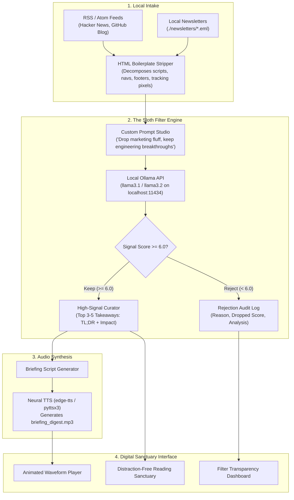

*This article is a submission for the **Hacktoberfest 2026 Week 3 Challenge: Slow and Steady**.*

---

## 🦥 What I Built

In 2026, the developer ecosystem suffers from an acute attention crisis: **infinite dopamine feeds, aggressive product marketing disguised as engineering blogs, and firehoses of unread newsletters**. 

Most of us subscribe to 20+ RSS feeds and developer newsletters with great intentions, only to face "inbox bankruptcy" and doomscroll through promotional fluff.

**SlothDigest** was built to restore digital sanctuary. Inspired by the calm, deliberate philosophy of the sloth—**"Slow and steady wins the signal race"**—SlothDigest is a **100% local-first, zero-cloud RSS and newsletter curator**.

Instead of demanding hours of reading:
1. **Unified Local Ingestion:** Ingests your RSS/Atom feeds (Hacker News, GitHub Engineering, Simon Willison) and local `.eml` email newsletter folders.
2. **HTML Boilerplate Stripping:** Purges tracking pixels, sponsor headers, and navigation chrome.
3. **The Sloth Filter Engine (Local Ollama):** Passes clean prose to an open-weight local LLM (`llama3.1:latest`, `llama3.2:1b`, or `qwen2.5:3b`) running privately on `localhost:11434`.
4. **Ruthless Fluff Elimination:** Discards 85%+ marketing noise, promotional pitches, and SEO listicles.
5. **Rejection Transparency Audit:** Logs every dropped article and the exact AI reasoning behind the drop.
6. **1-Minute Spoken Audio Briefing:** Synthesizes a daily editorial audio briefing MP3 with an animated 28-bar waveform player.

---

## 📸 Demo & Interface Walkthrough

SlothDigest is designed with an editorial, minimalist aesthetic inspired by Linear and Readwise Reader (deep slate `#06090e`, charcoal, muted forest green, and amber accents—no generic neon AI gradients).

### Key Views:
- **Daily High-Signal Digest:** Top 3–5 high-value takeaways featuring a high-impact **TL;DR**, core technical mechanics, **impact statement**, and reading time.
- **Interactive Audio Briefing:** Custom player with live animated waveform bars, speed toggle (1.0x – 2.0x), and scrub controls.
- **Unified Intake Dashboard:** Manage RSS URLs and point to local `./newsletters` email folders with real-time sync indicators.
- **Rejection Log View:** An audit trail showing what was dropped (e.g. *“Promotional launch pitch”*, *“Low information density”*).
- **Settings & Prompt Studio:** Fine-tune Ollama models, filtering strictness, and morning schedule times (e.g. 7:00 AM).

---

## 🏗️ Architecture & Tech Stack

SlothDigest runs entirely on your local machine with zero telemetry or subscription lock-in.



### Technology Breakdown:
- **Backend:** Python 3.10+, FastAPI, SQLite (`slothdigest.db`), Uvicorn.
- **Local AI:** [Ollama](https://ollama.com) running open-weight models (`llama3.1:latest`, `llama3.2:1b`, `qwen2.5:3b`) over local REST API with a heuristic fallback engine.
- **Feed & Mail Ingestion:** `feedparser`, `beautifulsoup4`, Python standard library `email` (RFC 822 / `.eml`).
- **Audio Engine:** `edge-tts` (neural voice synthesis) with offline `pyttsx3` fallback.
- **Frontend:** React 18, Vite, Tailwind CSS, Lucide icons.

---

## 🏃 Quickstart: Running SlothDigest

### 1. Clone & Setup
```bash
git clone https://github.com/AbhavyaManchanda/SlothDigest.git
cd SlothDigest
```

### 2. Install Dependencies
```bash
# Python backend
pip install -r requirements.txt

# React frontend
cd frontend
npm install
npm run build
cd ..
```

### 3. Ensure Local Ollama is Running
```bash
ollama pull llama3.1
# or a lightweight 1B model:
ollama pull llama3.2:1b
```

### 4. Launch the App
```bash
python run.py
```

Open **`http://localhost:8000`** in your browser.

---

## 🐢 Why "Slow and Steady" Matters

The theme for **Hacktoberfest 2026 Week 3 is "Slow and Steady"**, and it speaks directly to why SlothDigest was created:

1. **Combating Attention Fragmentation:** High velocity is not high signal. By intentionally bottlenecking content intake to a daily 3–5 item digest, we trade superficial skimming for deep architectural understanding.
2. **Open-Weight AI Belongs to Everyone:** You don't need a cloud subscription to have high-tier AI curation. A local 1B or 3B model running on consumer hardware can distill news without harvesting your browsing habits.
3. **Auditability Over Black Boxes:** Most AI feeds hide what they censor. SlothDigest provides an explicit **Rejection Log** so the reader remains in full control of their information diet.

---

## 🔗 Repository & Source Code

- **GitHub Repository:** [https://github.com/AbhavyaManchanda/SlothDigest](https://github.com/AbhavyaManchanda/SlothDigest)
- **License:** MIT License

---

## 🤖 AI Disclosure

SlothDigest was designed and developed with the assistance of agentic AI coding pairing (Gemini 3.8 Flash). The core application integrates local open-weight models (`llama3.1`) via Ollama for local-first inference.
