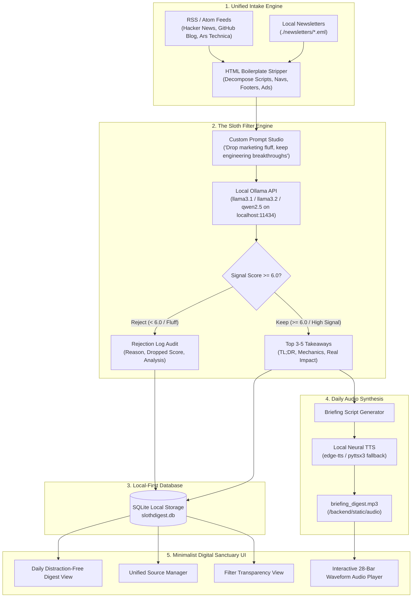

# 🦥 SlothDigest
### The Zero-Effort Local RSS & Newsletter Curator
> *“Slow and steady wins the signal race.”* Built for **Hacktoberfest 2026** (AI Belongs to Everyone).

[](LICENSE)
[](https://python.org)
[](https://fastapi.tiangolo.com)
[](https://react.dev)
[](https://ollama.com)
[](https://tailwindcss.com)

---

## 📖 Overview & Philosophy

Modern developer feeds have become overwhelming firehoses of marketing fluff, SEO link bait, sales pitches, and repackaged press releases. Most developers subscribe to 20+ RSS feeds and developer newsletters, only to leave them unread in inbox bankruptcy.

**SlothDigest** takes the opposite approach. Inspired by the calm, deliberate nature of the sloth, SlothDigest is a **100% local-first, privacy-respecting content sanctuary**. 

Instead of demanding hours of doomscrolling:
1. It ingests your raw RSS/Atom feeds and local email newsletter archives (`.eml`).
2. It strips all HTML boilerplates, navigation chrome, tracking pixels, and ads.
3. It passes clean article text to your **local Ollama instance** (`llama3.1:latest`, `llama3.2:1b`, or `qwen2.5:3b`).
4. It ruthlessly drops **85%+ marketing noise**, logging every discarded post in an audit view.
5. It distills the remaining breakthroughs into **3–5 high-value takeaways** and generates an **automated 1-minute daily audio briefing MP3**.

No cloud tracking. No subscription fees. No data leaves your machine.

---

## 🏛️ System Architecture



---

## ✨ Key Features

### 1. 🎛️ Unified Intake Dashboard
- Multi-source feed manager supporting standard RSS 2.0 and Atom feeds.
- **Local-First Newsletter Ingestion:** Drop raw `.eml` emails into `./newsletters` to parse sender, subject, and body without connecting to third-party mail servers.
- Live status indicators displaying real-time fetch health (`Syncing`, `Ready`, `Error`) and relative timestamp tracking.

### 2. 🧠 The Sloth Filter Engine (Local AI Processing)
- Connects directly to local Ollama over HTTP (`http://localhost:11434`).
- Automatically queries and selects locally installed models (`llama3.1:latest`, `llama3.2:1b`, `qwen2.5:3b`).
- Includes an intelligent local heuristic evaluator fallback if Ollama is paused or loading.
- **Filter Prompt Studio:** Editable natural language criteria with 1-click presets:
  - *Strict Systems & Compilers (Default)*
  - *AI & Open Weights Focus*
  - *Security & Infrastructure Vulnerabilities*
  - *Minimalist Dev Tools Only*

### 3. 🛡️ Complete Rejection Log Transparency
- Never wonder what the AI dropped. The audit view records:
  - Title & source of every discarded article.
  - Drop reason (e.g. *Marketing Fluff*, *Low Information Density*, *SEO Clickbait*).
  - Calculated signal score (e.g. `2.4 / 10`).
  - Searchable by keyword or filterable by drop category.

### 4. ☕ Daily High-Signal Digest View
- Editorial, calm, distraction-free reading sanctuary.
- Each takeaway features:
  - High-impact **TL;DR** banner.
  - Core technical mechanics & data point bullets.
  - **Impact statement** highlighting developer and architectural relevance.
  - Source pill, reading time estimate, and direct canonical link.
- One-click **Export to Markdown** for easy pasting into Obsidian, Notion, or dev.to.

### 5. 🎙️ 1-Minute Audio Briefing Player
- Generates a concise daily spoken audio briefing MP3 using local TTS (`edge-tts` / `pyttsx3`).
- Custom sleek dark-mode player with:
  - **Live animated 28-bar waveform visualizer**.
  - Interactive scrub bar with time duration tracking.
  - Playback speed multiplier toggle (1.0x, 1.25x, 1.5x, 2.0x).
  - Volume control and instant browser SpeechSynthesis fallback.

---

## 🛠️ Tech Stack

| Component | Technology | Purpose |
|---|---|---|
| **Backend** | Python 3.10+, FastAPI, Uvicorn | High-performance asynchronous REST API |
| **Local Storage** | SQLite (`slothdigest.db`) | 100% local, zero-config relational database |
| **Data Ingestion** | `feedparser`, `beautifulsoup4`, `email` | RSS/Atom feeds, HTML boilerplate stripping, `.eml` parsing |
| **Local AI Engine** | Ollama HTTP API (`localhost:11434`) | Open-weight LLMs (`llama3.1`, `llama3.2`, `qwen2.5`) |
| **Audio Synthesis** | `edge-tts`, `pyttsx3` | Natural neural daily briefing MP3 generation |
| **Frontend** | React 18, Vite, Tailwind CSS, Lucide | Minimalist dark-mode dashboard (`#06090e` / `#0f172a`) |

---

## 🚀 Getting Started

### Prerequisites
1. **Python 3.10+**
2. **Node.js 18+ & npm**
3. **Ollama** installed and running locally ([Download Ollama](https://ollama.com)):
   ```bash
   ollama pull llama3.1
   # Or a lightweight model:
   ollama pull llama3.2:1b
   ```

---

### Installation & Setup

1. **Clone the repository:**
   ```bash
   git clone https://github.com/AbhavyaManchanda/SlothDigest.git
   cd SlothDigest
   ```

2. **Install Python dependencies:**
   ```bash
   pip install -r requirements.txt
   ```

3. **Install Frontend dependencies & build production bundle:**
   ```bash
   cd frontend
   npm install
   npm run build
   cd ..
   ```

4. **Launch SlothDigest:**
   ```bash
   python run.py
   ```

5. **Open your browser:**
   - Unified Web App: **`http://localhost:8000`**
   - API Documentation: **`http://localhost:8000/docs`**

> **Development Mode:** If you wish to work on the React frontend with Vite hot module replacement (HMR), run `npm run dev` in `frontend/` (accessible at `http://localhost:3000`).

---

## 💡 Real-World Use Cases

### 1. Developer Morning Routine
Wake up, open SlothDigest, and hit **"Listen to Briefing"**. While making coffee, listen to a 60-second audio summary of the top 3 open-source releases and systems breakthroughs across 25 feeds—without opening Twitter or Reddit.

### 2. High-Signal Tech Leads & Architects
Filter out sensationalist startup funding rounds and sponsor blog posts. Focus exclusively on distributed systems postmortems, consensus algorithms, database optimizations, and zero-day patches.

### 3. Inbox Detox (Zero-Cloud Newsletter Reader)
Forward your Substack and developer newsletters into `.eml` files in `./newsletters`. Read clean, stripped summaries with zero tracking pixels, third-party cookies, or newsletter popups.

---

## 🏆 Hacktoberfest 2026: Week 3 Challenge ("Slow and Steady")

This project was built for the **Hacktoberfest 2026 Week 3 Challenge: Slow and Steady**. 

In an ecosystem flooded with rapid AI wrappers and infinite doomscrolling feeds, **SlothDigest embodies the deliberate, intentional pace of open source**. It proves that local, open-weight AI belongs to everyone and can be used to reclaim our attention and focus on true engineering craft.

---

## 📄 License

This project is licensed under the **MIT License** — see the [LICENSE](LICENSE) file for details.
